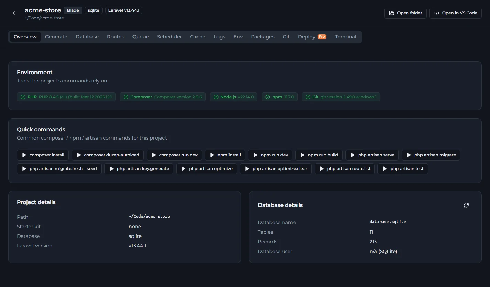
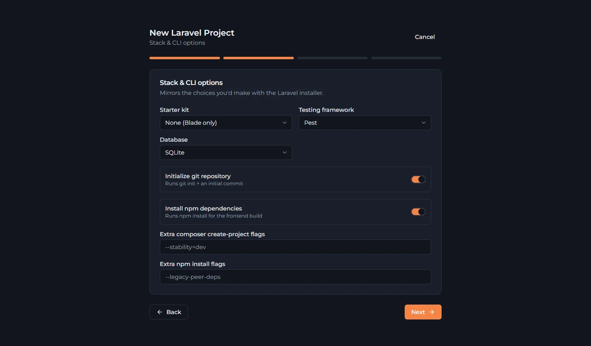
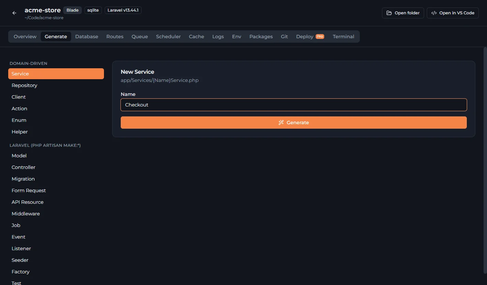
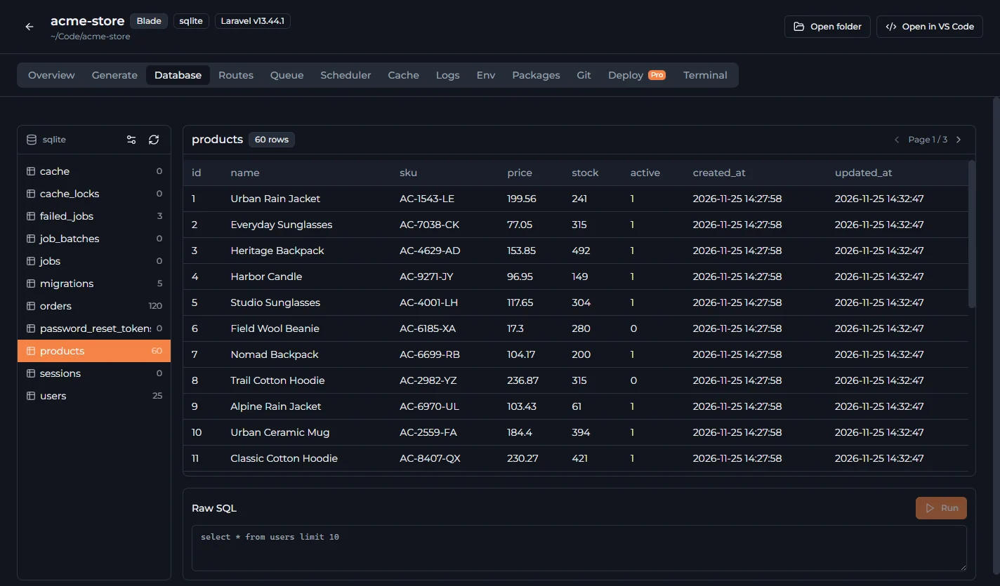
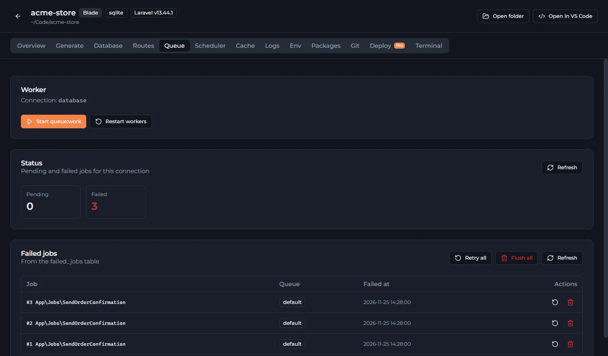
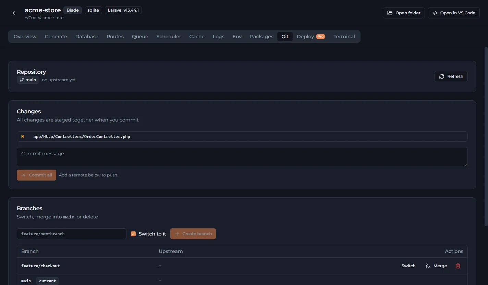

  

<h1 align="center">TuskForge</h1>

  <strong>The desktop app for scaffolding and managing Laravel projects.</strong> 
  Create a project with a starter kit and domain-driven structure, then run its database, routes, queues, scheduler, logs and Git from one window.

  <a href="https://github.com/developertrish/tuskforge-releases/releases/latest/download/TuskForge-Windows-Setup.exe"><strong>Download for Windows</strong></a>
  &nbsp;·&nbsp;
  <a href="https://tuskforge.dev/?utm_source=github&utm_medium=readme&utm_campaign=releases">Website</a>
  &nbsp;·&nbsp;
  <a href="https://tuskforge.dev/product?utm_source=github&utm_medium=readme&utm_campaign=releases">Product tour</a>
  &nbsp;·&nbsp;
  <a href="https://github.com/developertrish/tuskforge-releases/releases">All releases</a>

  

---

TuskForge is a free desktop app for Laravel developers. It uses the PHP, Composer, Node.js and Git already on your machine and gives every project a dashboard for the work you'd otherwise spread across terminals, database clients and browser tabs.

This repository hosts the installers and release notes. TuskForge checks it for new versions so it can offer to update itself.

## Download

| Platform | Installer |
| --- | --- |
| Windows 10/11 (x64) | [TuskForge-Windows-Setup.exe](https://github.com/developertrish/tuskforge-releases/releases/latest/download/TuskForge-Windows-Setup.exe) |
| macOS | Coming soon. [Get notified](https://tuskforge.dev/?utm_source=github&utm_medium=readme&utm_campaign=releases#download) when it's out. |

Run the installer, then open TuskForge. If Windows SmartScreen says it "protected your PC", choose **More info → Run anyway**.

### Requirements

TuskForge runs your project's commands with your own tools, so these need to be installed and on your `PATH`:

- **PHP** and **Composer**
- **Node.js** and **npm**
- **Git** (optional, for the Git tab and cloning)

The home screen checks each one and shows the version it found.

## What it does

### Start a project

- A four-step wizard that mirrors the Laravel installer
- Starter kits: Blade, Vue + Inertia, React + Inertia or Livewire
- Pest or PHPUnit, and SQLite, MySQL or PostgreSQL
- Optional `git init` with an initial commit, and `npm install`
- Pre-create Services, Repositories (bound for you), Clients, Actions, Enums and Helpers
- Or open a project already on disk, or clone one from Git

### Generate code

- Domain-driven: Service, Repository + interface, Client, Action, Enum, Helper
- Laravel: Model, Controller, Migration, Form Request, API Resource, Middleware, Job, Event, Listener, Seeder, Factory, Test
- Vue or React pages and components, or Livewire pages, matching your starter kit

### See your data

- Browse tables and rows on SQLite, MySQL or PostgreSQL, using the connection from your `.env`
- Run raw SQL in place
- Search every route by URI, name, action, middleware or HTTP method

### Keep it running

- Start `queue:work`, then retry, forget or flush failed jobs
- Read `schedule:list`, run due tasks now, or keep `schedule:work` going
- Cache or clear config, routes, events and views
- Read and clear `laravel.log`, and edit `.env`

### Ship it

- Commit, push, pull and fetch; create, switch, merge and delete branches
- Tabbed terminals that open in your project folder
- **Pro (coming soon):** one-click and auto-deploys to Laravel Cloud, Forge, Vapor, Ploi, Fly.io, Railway, Render, AWS, any SSH server and more

See every feature, with screenshots, in the **[product tour on tuskforge.dev](https://tuskforge.dev/product?utm_source=github&utm_medium=readme&utm_campaign=releases)**.

## Updates

TuskForge checks for a new release each time it starts and tells you when one is out. Choose to download it, and it installs on restart. You can also check any time from **Check for updates** on the home screen. Each release's notes are on the [releases page](https://github.com/developertrish/tuskforge-releases/releases).

## Help and feedback

Questions, bug reports and feature requests: [tuskforge.dev/contact](https://tuskforge.dev/contact?utm_source=github&utm_medium=readme&utm_campaign=releases).

---

  <a href="https://tuskforge.dev/?utm_source=github&utm_medium=readme&utm_campaign=releases">tuskforge.dev</a> 
  TuskForge is not affiliated with Laravel Holdings Inc.

